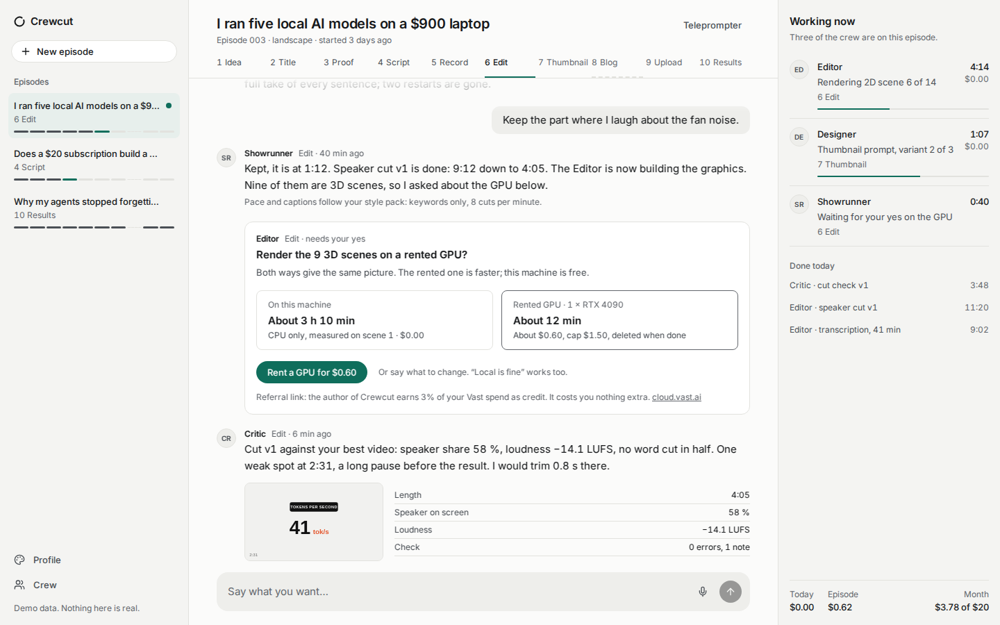
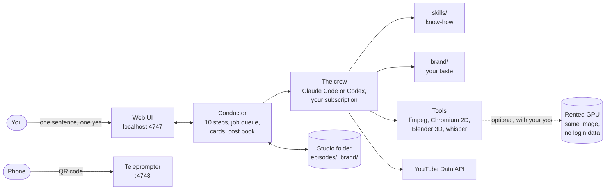

<div align="center">

# Crewcut

**A crew of AI agents that makes your whole YouTube video, from idea to upload. You record and approve.**

[](LICENSE)
[](https://github.com/marcopatzelt/crewcut/actions/workflows/ci.yml)
[](https://github.com/marcopatzelt/crewcut/actions/workflows/image.yml)

-d97757?style=flat-square)

</div>

Crewcut is an open-source YouTube studio that runs in one Docker container on your own computer. A crew of agents
(Showrunner, Scout, Writer, Editor, Critic, Designer, Publisher) finds the topic in data, writes title and script, cuts
your recording, builds 2D and 3D graphics in your style, makes the thumbnail and uploads through the YouTube API. You
say one sentence or give one yes at a few points. The agents run on **your own subscription**: Claude Code by default,
or Codex (beta). Heavy rendering runs on your machine, or on a GPU you rent for cents when you want it faster.

> **Status: v0.1, pre-release.** The pieces below are built and unit-tested, and the image is built and smoke-tested in
> CI for amd64 and arm64. A complete episode end to end has **not** been run yet; that is the next step. Features that
> do not exist yet are marked *planned*.

## Demo

<!-- Placeholder: a 60-second screen recording from the launch video goes here (no voice, English captions). -->
<picture>
  <source media="(prefers-color-scheme: dark)" srcset="docs/screenshot-dark.png">
  
</picture>

*The main screen with demo data (rendered in CI). Left: episodes with their ten steps. Middle: the chat with the
Showrunner, with one card that needs your yes. Right: who is working on what, and the money you spent.*

## Features

| | What it does | Status |
|---|---|---|
| **One command** | `docker compose up`, then `localhost` in the browser. Same image on Linux, macOS (Apple chips) and Windows | built; image tested in CI |
| **The whole chain** | idea from data, title and thumbnail text before the script, proof test, script, teleprompter, speaker cut, 2D and 3D inserts, sound, checks, thumbnail, upload | built; not yet run end to end |
| **Your subscription, two engines** | Claude Code (default) or Codex, picked once by saying it; one interface: start, live events, stop, resume | Claude Code built; Codex **beta** (not yet run on a real episode) |
| **A crew with roles** | seven crew members plus Brand for onboarding, each with its own skills and rights; only the Editor may rent, only the Publisher may publish; the Critic never checks its own work | built |
| **No forms** | onboarding is "paste your links"; corrections are one sentence or voice; every decision is one card with one button | built |
| **Your style, not ours** | a neutral default style; the Brand agent builds your style pack from your website and channel and shows a 10-second sample | built; not yet run on a real brand |
| **Rules that learn** | a correction becomes a proposed rule with date and your words; one yes adds it to your pack | built |
| **Approve exactly what you saw** | a card stores the checksum of the file you saw; any change is a new version | built, tested |
| **GPU on demand, never required** | estimate for both ways, approval, budget, cap, auto-delete, watchdog, cost book; everything also runs locally | built, tested against a fake provider; no real rental yet |
| **Web teleprompter** | the script on your phone through a QR code, with a remote | built |
| **Upload through the API** | resumable upload, thumbnail, captions, schedule, AI disclosure; no browser clicking | built; not yet run against a real channel |
| Shorts, music generation, blog, A/B test results, 48-hour check | | *planned* |

## Quick start

```bash
git clone https://github.com/marcopatzelt/crewcut.git && cd crewcut
claude setup-token     # once, on any computer with a browser: prints your engine token
./start.sh             # asks for the token once (hidden), writes .env, runs docker compose up
```

Open **http://localhost:4747**, paste your links, then say your first idea. Details, Windows and GPUs:
[docs/getting-started.md](docs/getting-started.md).

## How it works



1. **The conductor** holds the order of the ten steps (idea, title, proof, script, record, edit, thumbnail, blog,
   upload, results) and wakes the right crew member. It costs no tokens.
2. **Each crew member** is a run of your Claude Code (or Codex) with a short identity ("how I work"), the skill of its step and
   the state of the episode. It reports what it does in the Crew column and asks for decisions only with cards.
3. **Skills** hold the know-how without taste. **Your style pack** (`brand/`) holds the taste: colours, fonts, logo,
   pace, captions, loudness, your rules. Updates of the app never touch it.
4. **Heavy work** (renders, transcription, assembly) runs one job at a time on your machine. For 3D and long jobs the
   Editor estimates both ways and may suggest a rented GPU. Nothing is rented without your yes.

More: [docs/architecture.md](docs/architecture.md), [docs/api.md](docs/api.md), [DESIGN.md](DESIGN.md).

## The crew

| Mark | Crew member | Role | Skills |
|---|---|---|---|
| SR | **Showrunner** | Runs the episode through the ten steps, answers you in the chat, shows nothing unchecked | `episode` |
| SC | **Scout** | Finds the topic in data, writes title and thumbnail text, proves the promise | `idea`, `title` |
| WR | **Writer** | Writes the script in your voice | `script` |
| ED | **Editor** | Ingests recordings, cuts the speaker, builds 2D and 3D, sound and assembly; the only one who may rent | `edit`, `3d-scene` |
| CR | **Critic** | Checks every version against your best video before you see it; never the builder | `cut-check` |
| DE | **Designer** | Thumbnail and test variants | `thumbnail` |
| PU | **Publisher** | Upload package and upload; the only one who may publish | `upload` |
| BR | **Brand** | Onboarding and your style pack; names the source of every value | `onboarding` |

Identities live in [`team/`](team/README.md), one small file each. Every crew member has a short soul (how it works) that rides every run; the long
knowledge stays in its skills.

## Built on the playbooks of

The skills distil public know-how from these creators into our own short rules. The crew names the method when it
applies one ("Scout: niche check after Vexian's growth stages").

| Source | What the crew learned | Used by |
|---|---|---|
| **Vexian**, in Grant Owen's podcast ["The Crazy Genius Who Solved The Youtube Algorithm"](https://www.youtube.com/watch?v=41HMFGbENj4) | finding a niche and topics, growing in stages, titles and thumbnails | Scout, Writer, Designer, Publisher |
| **MrBeast**'s production handbook ([public since 2024](https://simonwillison.net/2024/Sep/15/how-to-succeed-in-mrbeast-production/)) | the first minute; title and thumbnail before the shoot | Scout, Writer, Showrunner |
| **Alex Hormozi**'s editing and caption style, by his editor Ryan Magin ([channel](https://www.youtube.com/@AlexHormozi)) | fast cutting, word captions | Editor, Critic |
| **[fern](https://www.youtube.com/@fern-tv)** (YouTube channel) | inspiration for the 3D clay look | Editor, Designer |
| **[Nate Herk](https://www.youtube.com/@nateherk)** | a title for everyone, the business inside the video; Shorts as proof | Scout |
| Reel storytelling of [Farza](https://www.youtube.com/@farzatv), [Chris Raroque](https://www.youtube.com/@raroque), [Roy Lee](https://www.youtube.com/@im_roy_lee), [Riley Brown](https://www.youtube.com/@rileybrownai), [Varun Mayya](https://www.youtube.com/@VarunMayya), [Codie Sanchez](https://www.youtube.com/@CodieSanchezCT) | first person, the turn, uneven numbers | Writer |

Crewcut is not affiliated with or endorsed by any of these creators. The skills contain our own summaries, not their
content.

## Style packs and onboarding

Crewcut starts with a calm **neutral style** (`packs/neutral/`): Inter, black, white and one accent, quiet cards and
counters, no logo, captions as keywords. On the first start you paste your links (website, channel, social). The Brand
crew member reads them: logo and colours and fonts from your site's CSS, tone from your texts, patterns from your recent
videos. It writes your pack to `studio/brand/` with the source of every value, renders a 10-second sample in your style
and shows one profile card. If something is off, say it ("no captions", "logo smaller"); that sentence becomes your
first rule.

```
brand/
  brand.json        colours, fonts, logo, shape, motion, 3D stage
  edit-style.json   pace, captions, music, loudness, mix limits, speaker share
  channel.json      niche, audience, language, tone, topics to avoid
  thumbnail.json    layouts, face, max words, reference photo
  voice.md          how you speak
  rules/<step>.md   learned rules with date and your words
```

Paid fonts are never downloaded from other sites; the Brand agent picks a similar free font and says so.
[`examples/striq/`](examples/striq/) shows a real, dated style pack (the author's channel): rules and values only, no
logo, no photos, no fonts. See [docs/style-packs.md](docs/style-packs.md).

## Rented GPUs or your own machine

Everything runs without renting. On a laptop CPU, the 3D scenes of the author's style took about 144 seconds per frame;
a three-second 3D insert is then about three hours. A rented RTX 4090 renders the same frame in roughly 20 to 70
seconds at about $0.35 to $0.50 per hour, so a whole episode's 3D cost the author a few dollars. 2D graphics, cutting
and sound need no GPU at all.

Before a heavy job the Editor estimates both ways and, only when renting saves a lot, suggests it once:

> 9 scenes: about 3 h on this machine, or about 12 min for about $0.60 on a rented GPU. **[Rent a GPU]** · Local is fine too.

Nothing is rented without your yes. Every rental has a budget and a monthly cap, an on-machine watchdog with a deadline,
a local guard that deletes forgotten machines, and a cost book entry with proof that no machine is left. Only scene code
and fonts go to the rented machine, never your recordings (unless you approve it on a card) or keys.

**Referral disclosure:** Crewcut suggests Vast.ai through the author's referral link; the author earns 3% of your Vast
spend as credit. Change or remove it in `config/compute.toml`. If you already have a Vast key, Crewcut does not show the
link at all. Details: [docs/compute.md](docs/compute.md).

## Configuration

You do not need to configure anything to start. Defaults live in `config/*.toml`; to change one, copy the key into the
same file name under `studio/config/`. Secrets live only in `.env`.

| File | What |
|---|---|
| `.env` | `CLAUDE_CODE_OAUTH_TOKEN` (for Claude Code), `VAST_API_KEY`, `OPENAI_API_KEY`, `YOUTUBE_API_KEY` (optional); Codex logs in through the chat |
| `config/crewcut.toml` | engine and its models, parallel agents, heavy lane, monthly cap, ports |
| `config/compute.toml` | provider, GPU preference, price limit, referral link |
| `config/thumbnail.toml` | image way (Codex or image API), size, price estimate |
| `config/speech.toml` | speech recognition model and device |

## Roadmap

| Stage | Content | Status |
|---|---|---|
| 0, foundation | studio extracted from the author's setup, taste moved into style packs, neutral style, Docker image for amd64 and arm64, CI | done (this repository) |
| 1, v0.1 | the 14 points of the MVP: one command, ten steps, cards, teleprompter, speaker cut, 2D, 3D local and rented, assembly and checks, thumbnail, API upload, learned rules, onboarding, the live crew column | built; first full episode next |
| 2, whole chain | Shorts, music through rented GPUs, analytics and the 48-hour check, A/B variants with guidance, rule review, approval from the phone, style measured from your own videos, all crew identities | planned |
| 3, for everyone | shareable style packs, your own 3D stage and models, data packs per language and niche, more GPU providers, Codex out of beta | planned |
| 4, breadth | blog, Instagram output, a small Mac app that starts Docker for you (Apple speech recognition, SD card detection) | planned |

## FAQ

**Do I need a GPU or a Mac?** No. Any computer with Docker works. A GPU (your own NVIDIA card or a rented one) only
makes 3D and transcription faster.

**What does it cost?** Your Claude or ChatGPT plan (the crew runs on it) and, only if you choose, rented GPU time and paid image
APIs. The money row in the app shows every cent; there is a monthly cap.

**Does it work on Apple chips?** The image is built for arm64. Docker on macOS cannot use the Apple GPU, so 3D runs on a
rented GPU there; a bridge to Blender on the Mac itself is planned. A test on a real Mac is still to come.

**Does the AI film me?** No. You record. Crewcut prepares the script and teleprompter before, and does the rest after.

**Is my data uploaded anywhere?** No account, no server, no telemetry. Your studio folder stays on your computer.
Agents use your Claude login; uploads go to your YouTube channel only after your yes.

**Which engines?** Exactly two, both on your own subscription: Claude Code (default) and Codex (beta). Say "use Codex"
in the chat to switch. No API keys needed. Details: [docs/engine.md](docs/engine.md).

## Documentation

| Page | What |
|---|---|
| [Getting started](docs/getting-started.md) | install, first run, where your files are |
| [Architecture](docs/architecture.md) | the two roots, commands, the ten steps, the edit plan, the database |
| [Engines](docs/engine.md) | Claude Code and Codex: login, events, resume, known problems |
| [Style packs](docs/style-packs.md) | every key of `brand/` and its neutral default |
| [Recording and cut](docs/recording.md) | before you record, ingest, transcription, speaker cut |
| [Rendering](docs/rendering.md) | 2D scenes, 3D local and rented, the preview |
| [Compute](docs/compute.md) | rented GPUs: estimate, money rules, delete safeguards, privacy, the referral link |
| [YouTube](docs/youtube.md) | connecting your channel, what the upload does, honest limits |
| [Web UI](docs/ui.md) and [DESIGN.md](DESIGN.md) | the three places, demo mode, the design rules and their checks |
| [HTTP API](docs/api.md) | what the UI talks to |
| [Integration tests](docs/integration-test.md) | the tests that need real machines and a real login |

## Contributing

Issues and pull requests are welcome. Read [CONTRIBUTING.md](CONTRIBUTING.md), [DESIGN.md](DESIGN.md) for UI work and
[SECURITY.md](SECURITY.md) for reporting security problems. Please follow the [code of conduct](CODE_OF_CONDUCT.md).

## License

[MIT](LICENSE), copyright Marco Patzelt. Third-party tools keep their own licences: ffmpeg (LGPL/GPL build from Debian),
Blender (GPL, called as a program, not linked), Chromium (BSD), Inter (SIL Open Font License), Claude Code and Codex
(installed from their official packages at first start, not shipped).
