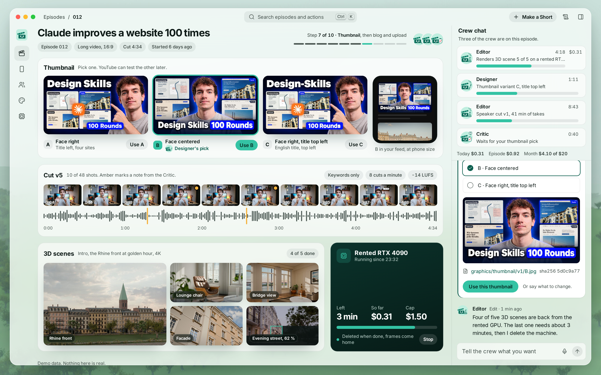
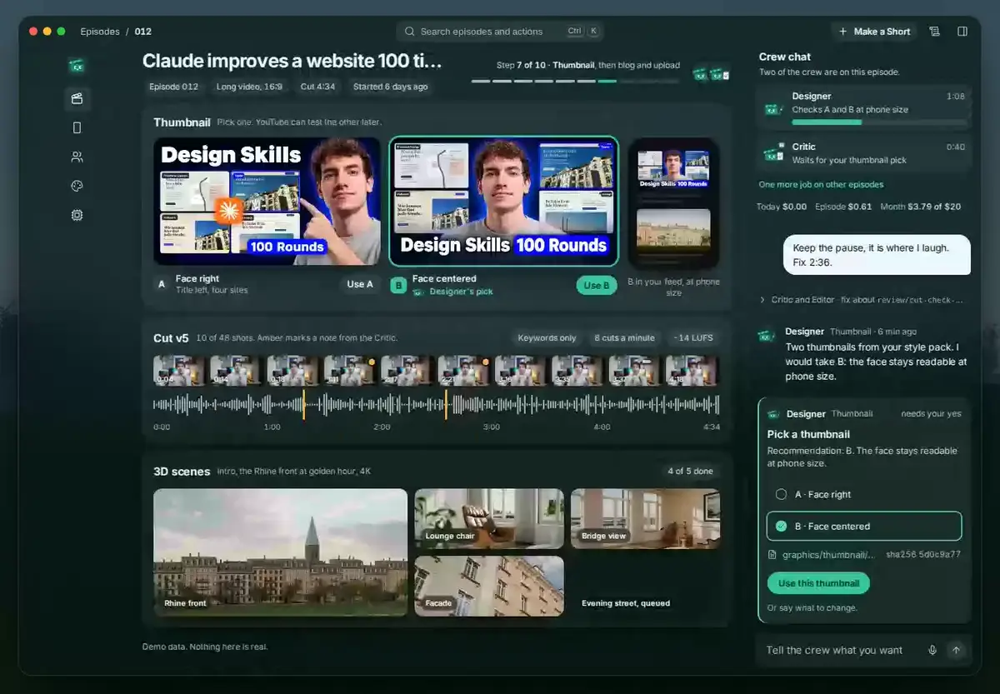
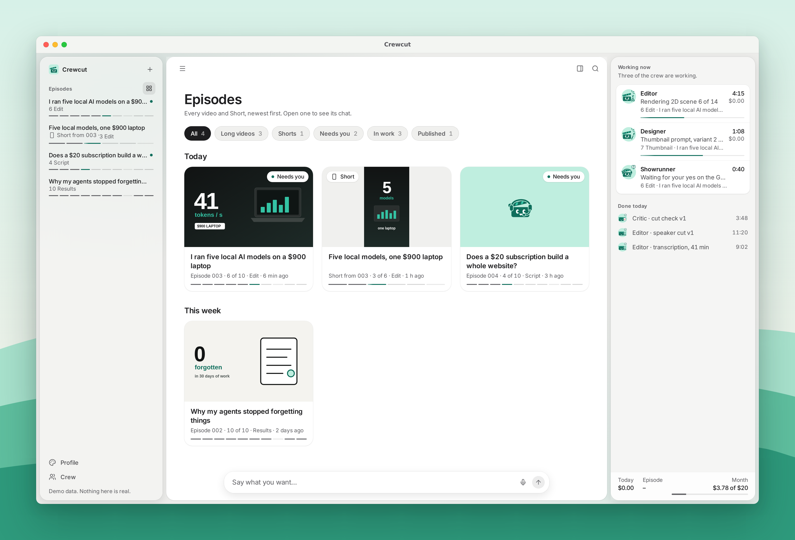
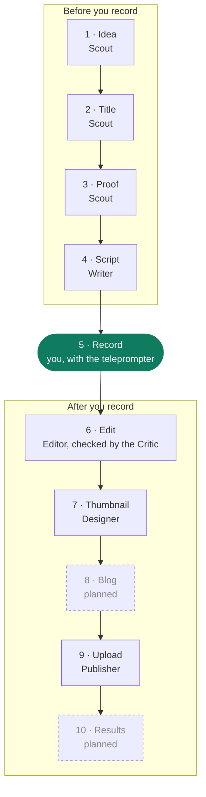
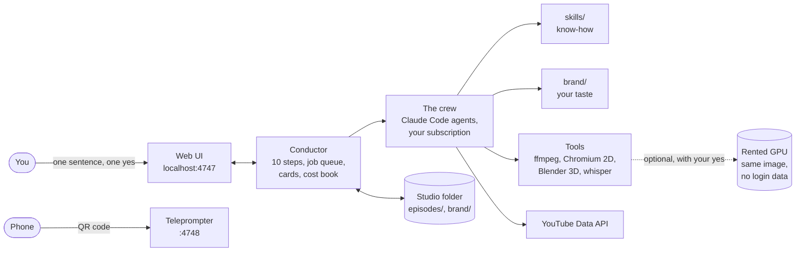

<div align="center">

<picture>
  <source media="(prefers-color-scheme: dark)" srcset="docs/brand/slate-dark.svg">
  
</picture>

# Crewcut

### Your Claude Code subscription, now a YouTube crew.

**Seven AI agents take your video from idea to upload. You record and say yes.<br>
Open source, one Docker container, on your own computer.**

[](LICENSE)
[](https://marcopatzelt.github.io/crewcut/)
[](https://github.com/marcopatzelt/crewcut/actions/workflows/ci.yml)


**[Website](https://marcopatzelt.github.io/crewcut/)** · [Quick start](#quick-start) · [How it works](#how-it-works) · [Shorts](docs/shorts.md)

<br>

https://github.com/user-attachments/assets/1a299daa-9e75-48cb-b0f1-da97c4894bdc

<sub>Made with Crewcut's own motion tools: EffectCraft and Blender on one rented GPU, 1.75 $. [How it was built](examples/launch-film/) · Film credits: [docs/launch/SOUNDS.md](docs/launch/SOUNDS.md)</sub>

<br>

<picture>
  <source media="(prefers-color-scheme: dark)" srcset="docs/readme/crewcut-dark.png">
  
</picture>

</div>

**Crewcut is for people who make YouTube videos alone and appear in them.** You bring the idea and the recording. The
crew does the rest: it finds the topic in data, writes title and script, cuts your takes, builds 2D, 3D and motion
graphics in your style, checks every version, makes the thumbnail and uploads through the YouTube API. It runs on the Claude Code
subscription you already pay for, so the crew needs no API keys.

You see who works on what, live. Every decision is one card with one button: no forms, no settings dialogs. Nothing is
published, rented or paid for without your yes.

> **Status: v0.1, pre-release.** Except features marked *planned*, the work is built and unit-tested. The image is built and
> smoke-tested in CI for amd64 and arm64, with real 2D, 3D and assembly renders. A full episode with real footage has
> **not** run yet; that is the next step. What does not exist yet is marked *planned*. The pictures show sample data.



<p align="center"><sub>Media first, the crew chat beside it. Sample data from the author's own videos, rendered in CI from the current app.</sub></p>

<picture>
  <source media="(prefers-color-scheme: dark)" srcset="docs/readme/crewcut-episodes-dark.png">
  
</picture>

<p align="center"><sub>Every video and Short at a glance, and live pictures of the work in progress.</sub></p>

## Quick start

You need Docker and a Claude subscription (Pro, Max, Team or Enterprise).

```bash
git clone https://github.com/marcopatzelt/crewcut.git && cd crewcut
./start.sh             # writes .env, runs docker compose up, opens Crewcut in its own window
```

Press **Connect Claude**: Claude's own sign-in page opens, you sign in and paste the code it shows. No terminal and no
token to copy (on a server without a screen, `./start.sh` also takes a token from `claude setup-token`).

When the server answers, Crewcut opens in its own window (an app window of Chrome, Edge, Brave, Arc or Chromium; else
your default browser) at **http://localhost:4747**. Paste your links (website, channel), and say your first idea:

> Next video: I ran five local AI models on a $900 laptop. Which one is worth it?

The Scout comes back with a topic card. `./start.sh --no-open` only prints the address; `crewcut open` opens the window
again. To keep Crewcut in your dock or start menu, install it as an app: in Chrome or Edge the install icon in the
address bar, in Safari File → Add to Dock. Details, Windows and GPUs: [docs/getting-started.md](docs/getting-started.md).

### Download the app

*Coming with the first release.* Crewcut also comes as a desktop app for macOS, Windows and Linux: it checks Docker,
downloads Crewcut with a progress bar, connects Claude with one button (the login stays in your system's keychain) and
opens the studio in its own window. On a Mac, one line installs it:

```bash
curl -fsSL https://raw.githubusercontent.com/marcopatzelt/crewcut/main/install.sh | sh
```

Windows (`.exe`) and Linux (`.AppImage`, `.deb`) download from the releases page. The first release is not signed by
Apple or Microsoft yet; the one extra click is in [docs/desktop.md](docs/desktop.md).

## How it works

Ten steps. The crew works between them; you decide at each card.



| Step | What the crew does | What you decide |
|---|---|---|
| 1 Idea | The Scout looks at what works in your niche and ranks topics, title and thumbnail first | the topic |
| 2 Title | Writes title and thumbnail text before a word of script exists | the title |
| 3 Proof | Runs the test the title promises and collects the numbers that go into the video | what goes in |
| 4 Script | The Writer writes in your voice, then runs [Humanizer](https://github.com/blader/humanizer) over the draft with your own spoken words as the sample | the script; the card shows what Humanizer changed |
| 5 Record | Puts the script on your phone as a teleprompter (QR code, with a remote) | you record |
| 6 Edit | The Editor transcribes, cuts to the last full take of each sentence, plans the motion graphics from what each moment must show (what fits from the shelf, what to build new, what makes this video better than the last), builds 2D, 3D and motion, mixes the sound; the Critic checks every version against your best video before you see it | the motion plan, style frames, the preview |
| 7 Thumbnail | The Designer makes the thumbnail and test variants | the thumbnail |
| 8 Blog | *planned* | |
| 9 Upload | The Publisher uploads through the API: video, thumbnail, captions, schedule, YouTube's altered-or-synthetic-content answer | publish, every time |
| 10 Results | *planned*: the 48-hour check | |

**Shorts, two ways.** A *clip* comes from a finished episode: the Scout finds passages that stand on their own, the
Editor cuts them from your original recording in 9:16 around your face. An *original* is recorded for itself: three
ideas with a proof from your real work, you talk for two minutes, the Writer shortens your own words, you record only
yourself. One card per Short, or your own standing approval for Shorts. See [docs/shorts.md](docs/shorts.md).

Every correction is one sentence, typed or spoken ("keep the part where I laugh", "no captions"). A correction that should
last becomes a proposed rule with the date and your words; one yes adds it to your style pack.

## Why it is different

These are rules in the code, not settings a prompt can talk around.

- **You film yourself.** Crewcut makes no AI presenter and no AI voice. The video is your recording.
- **You approve exactly what you saw.** A card stores the checksum of the file you looked at. Any change is a new version
  and needs a new yes.
- **Nothing is published or paid for without your card.** Only the Publisher may upload, only the Editor may rent, and
  both still need your card. A monthly cap stops all spending (default $20).
- **The builder never checks its own work.** The Critic checks every cut before you see it.
- **Your recordings stay on your computer.** Only scene code and fonts go to a rented GPU, never your footage (unless you
  approve it on a card), never your keys.
- **Your taste is yours.** Skills hold the know-how; your style pack holds the taste. Updates of the app never touch it.
- **The newest Claude Code, with a way back.** A new Claude Code release is live at the next start, after a smoke test.
  If it fails twice, Crewcut goes back to the last good version and tells you. Every Claude Code flag passes through.

## Meet the crew

### Showrunner leads. The specialists make the episode.

<p align="center">
  
  <br><strong>Showrunner</strong><br>Channel plans → episode tasks → specialist work
</p>

Showrunner coordinates channel plans and episode tasks. It is the existing Showrunner, not a ninth crew member.
The seven specialists work beneath this shared lead, each with its own role.

**Channel conversation:** Showrunner connects the whole channel to focused episode work:

1. **Channel chat:** ask what is ready or discuss what to make next, without choosing an episode.
2. **Showrunner:** reviews the channel plan and assigns requested work to the relevant episode specialists.
3. **Episode chat:** open an episode for its media, progress and specific changes.

An ordinary channel question does not start a new episode. Paid actions and publishing still require your approval.
See the [channel workspace plan](docs/channel-workspace-plan.md) for the design and approval boundaries.

#### Episode specialists

<p align="center">
  
  
  
  
  
  
  
</p>

Every crew member is **Slate**, the Crewcut clapperboard, with the tool of its role. In the app Slate also shows the
state: asleep while it waits its turn, the bar ticking while it works, a small "?" sign when it needs you, the bar shut
with a check when it is done.

| | Crew member | What it does | May |
|---|---|---|---|
|  | **Scout** | Finds the topic in data, writes title and thumbnail text, runs the proof | |
|  | **Writer** | Writes the script in your voice | |
|  | **Editor** | Ingests your recordings, cuts the speaker, builds 2D and 3D, sound and assembly | rent a GPU, with your card |
|  | **Critic** | Checks every version against your best video; never the one who built it | |
|  | **Designer** | Thumbnail and test variants | |
|  | **Publisher** | Upload package and upload | publish, with your card |
|  | **Brand** | Onboarding: builds your style pack from your links and names the source of every value | |

Each crew member is a real Claude Code agent (`crewcut:editor`, …) with a short identity in [`team/`](team/README.md) and
the skills of its step in [`skills/`](skills/). Crewcut loads itself into Claude Code as a plugin, so your own
`.claude/` settings, skills and MCP servers keep working.

## Your style, from your links

Crewcut starts with a calm neutral style: Inter, black and white, one accent, quiet cards and counters, captions as
keywords. On the first start you paste your links. The Brand crew member reads them: logo, colours and fonts from your
site's CSS, tone from your texts, patterns from your recent videos. It writes your style pack to `brand/` with the
source of every value, renders a 10-second sample in your style and shows you one profile card.

```
brand/
  brand.json        colours, fonts, logo, shape, motion, 3D stage
  edit-style.json   pace, captions, music, loudness, speaker share
  channel.json      niche, audience, language, tone, topics to avoid
  thumbnail.json    layouts, face, max words, reference photo
  voice.md          how you speak
  rules/<step>.md   learned rules, with date and your words
```

Paid fonts are never downloaded from other sites; Brand picks a similar free font and says so. [`examples/striq/`](examples/striq/)
is a real, dated style pack from the author's channel (rules and values only). See [docs/style-packs.md](docs/style-packs.md).

## Fast with a rented GPU, free without one

Everything runs on your computer. 2D graphics, cutting and sound need no GPU. 3D is the slow part: on a laptop CPU, a
frame of the author's 3D style took about 144 seconds, so a three-second 3D insert takes about three hours. A rented
RTX 4090 renders the same frame in about 20 to 70 seconds, at about $0.35 to $0.50 per hour. Crewcut rents the 4090 by
default and never pays more than $0.60 per GPU-hour (you can change the cap); faster, pricier cards like the RTX 5090
only when you name them. Scenes are built and tested on your machine or one GPU; several GPUs are rented only for the
final render and deleted right after, and any machine that waits without work is deleted after a few minutes. The card
says what waiting would cost.

Before a heavy job the Editor estimates both ways and, only when renting saves a lot, asks once:

> 9 scenes: about 3 h on this machine, or about 12 min for about $0.60 on a rented GPU. **[Rent a GPU]** · Local is fine too.

Choose this machine and it does not ask again in that episode. Every rental has a budget, a monthly cap, a price cap per
GPU-hour, an idle cut-off, a watchdog with
a deadline on the machine, a local guard that deletes forgotten machines, and an entry in the cost book with proof that
nothing is left running.

**Referral disclosure:** Crewcut suggests Vast.ai through the author's referral link. The author earns 3% of your Vast
spend as credit; it costs you nothing extra. Change or remove it in `config/compute.toml`. If you already have a Vast
key, Crewcut does not show the link. Details: [docs/compute.md](docs/compute.md).

## How Crewcut compares

Other open-source video agents are good at other jobs. From each project's README on 16 November 2026:

| | Starts from | The picture | Runs on |
|---|---|---|---|
| **Crewcut** | your idea and **your recording** | your takes, cut, with 2D and 3D graphics in your style | your Claude Code subscription (Codex in beta) |
| [youtube-automation-agent](https://github.com/darkzOGx/youtube-automation-agent) | topics it researches for your channel | generated narration and visuals; a local slideshow by default, AI video providers optional | an API key for a text provider (Gemini, OpenAI, OpenRouter, DeepSeek and others) |
| [OpenFilm](https://github.com/openfilm/openfilm) | a prompt to your coding agent | films written as web pages, with a local editor to change anything | Codex, Claude Code or any coding agent; your own keys for generated media |
| [MoneyPrinterTurbo](https://github.com/harry0703/MoneyPrinterTurbo) | a topic or keyword | HD short videos from an automated workflow | API keys for model providers |

Pick Crewcut when you stand in front of the camera yourself and want everything around the recording done. Corrections
to this table are welcome.

## Two engines

| Engine | Status | Login |
|---|---|---|
| **Claude Code** | default | "Connect Claude" once (Claude's own sign-in, no terminal); the token stays in the environment, or in the system keychain with the desktop app |
| **Codex** | beta, not yet run on a real episode | say "use Codex": a sign-in link and a one-time code appear in the chat |

Both run on your own subscription. Switch by saying it ("use Codex", "back to Claude"). Crewcut never pins the engine:
each start brings the newest release, with a smoke test and a way back. Details: [docs/engine.md](docs/engine.md).

## Built on the playbooks of

The skills distil public know-how from these creators into our own short rules. The crew names the method when it
applies one ("Scout: niche check after Vexian's growth stages").

| Source | What the crew learned | Used by |
|---|---|---|
| **Vexian**, in Grant Owen's podcast ["The Crazy Genius Who Solved The Youtube Algorithm"](https://www.youtube.com/watch?v=41HMFGbENj4) | finding a niche and topics, growing in stages, titles and thumbnails | Scout, Writer, Designer, Publisher |
| **MrBeast**'s production handbook ([public since 2024](https://simonwillison.net/2024/Sep/15/how-to-succeed-in-mrbeast-production/)) | the first minute; title and thumbnail before the shoot | Scout, Writer, Showrunner |
| **Alex Hormozi**'s editing and caption style, by his editor Ryan Magin ([channel](https://www.youtube.com/@AlexHormozi)) | fast cutting, word captions | Editor, Critic |
| **[fern](https://www.youtube.com/@fern-tv)** (YouTube channel) | inspiration for the 3D clay look | Editor, Designer |
| **[Nate Herk](https://www.youtube.com/@nateherk)** | a title for everyone, the business inside the video; Shorts as proof | Scout |
| Reel storytelling of [Farza](https://www.youtube.com/@farzatv), [Chris Raroque](https://www.youtube.com/@raroque), [Roy Lee](https://www.youtube.com/@im_roy_lee), [Riley Brown](https://www.youtube.com/@rileybrownai), [Varun Mayya](https://www.youtube.com/@VarunMayya), [Codie Sanchez](https://www.youtube.com/@CodieSanchezCT) | first person, the turn, uneven numbers | Writer |

Crewcut is not affiliated with or endorsed by any of these creators. The skills contain our own summaries, not their
content.

## Motion graphics

The film at the top was made with these tools. Motion graphics in a video start from the video, not from a template
list: per moment the Editor asks what the viewer must understand, then looks at the shelf, and builds a new piece when
the idea needs one (with a style-frame card first). Every video gets one named upgrade over your best one so far; the
Critic writes the lessons the next video reads. Comps render with [EffectCraft](https://github.com/storytold/effectcraft)
(open source, built from a pinned commit), heavy 3D words with Blender, graphics can sit behind you through a person
matte with its own edge check (it falls back to beside you when the edges are not clean), and every sound effect is
made by code. [Motion graphics](docs/motion.md) · [The workflow](docs/motion-workflow.md) ·
[Behind the speaker](docs/motion-matte.md) · [Templates](templates/motion/README.md)

## Under the hood



- **The conductor** holds the order of the steps and wakes the right crew member. It costs no tokens.
- **Each crew member** is a run of your Claude Code with its identity, the skill of its step and the state of the
  episode. It reports what it does in the crew column and asks for decisions only with cards.
- **Heavy work** (renders, transcription, assembly) runs one job at a time, on your machine or, with your yes, on a
  rented GPU from the same image.
- **Configuration** is optional: defaults live in `config/*.toml`, your changes in `studio/config/`, secrets only in
  `.env`. You can also just say it ("use the highest effort for the Critic").

More: [docs/architecture.md](docs/architecture.md), [docs/api.md](docs/api.md), [DESIGN.md](DESIGN.md).

## FAQ

**Does the AI film me or speak for me?** No. You record. Crewcut prepares script and teleprompter before, and does the
rest after.

**What does it cost?** Your Claude plan (or ChatGPT plan for Codex). Rented GPU time and paid image APIs only if you
choose them; the money row in the app shows every cent, and there is a monthly cap.

**Do I need a GPU or a Mac?** No. Any computer with Docker works: Linux, Windows, macOS on Apple chips. A GPU (your own
NVIDIA card or a rented one) only makes 3D and transcription faster. Docker on macOS cannot use the Apple GPU, so 3D runs
on the CPU or a rented GPU there. A test on a real Mac is still to come.

**Is my data uploaded anywhere?** No account, no Crewcut server, no telemetry. Your studio folder stays on your computer.
The crew uses your Claude login; uploads go to your YouTube channel only after your yes.

**How does Crewcut connect to my channel?** Through the YouTube Data API, the only upload path. The one-time setup in
the Google Cloud console is done for you: say "connect YouTube", press **Set it up in my Chrome**, and your own Claude
Code with Claude in Chrome creates the project and the client while you watch; you only sign in and allow it. Details
and the manual way: [docs/youtube.md](docs/youtube.md).

**Can I use my own Claude Code setup?** Yes. Crewcut is a Claude Code plugin. Your `.claude/` settings, skills, agents
and MCP servers keep working, and any Claude Code flag can be passed through.

**Can the crew members talk to each other?** Built, and off until it is measured: the Critic can send its findings
straight to the Editor, with hard limits. See [docs/crew-talk.md](docs/crew-talk.md).

## Roadmap

| Stage | Content | Status |
|---|---|---|
| 0, foundation | studio extracted from the author's own setup, taste moved into style packs, Docker image for amd64 and arm64, CI | done |
| 1, v0.1 | one command, ten steps, cards, teleprompter, speaker cut, 2D, 3D local and rented, checks, thumbnail, API upload, learned rules, onboarding, live crew column, Humanizer pass, YouTube setup through Chrome, Shorts (clip and original) | built; first full episode next |
| 2, whole chain | music on rented GPUs, the 48-hour check for long videos, A/B variants, approval from the phone, style measured from your own videos, a crop that follows a moving speaker | *planned* |
| 3, for everyone | shareable style packs, your own 3D stage and models, more GPU providers, Codex out of beta | *planned* |
| 4, breadth | blog, Instagram output, a small Mac app that starts Docker for you | *planned* |

## Documentation

[Getting started](docs/getting-started.md) ·
[Architecture](docs/architecture.md) ·
[Engines](docs/engine.md) ·
[Style packs](docs/style-packs.md) ·
[Recording and cut](docs/recording.md) ·
[Rendering](docs/rendering.md) ·
[Motion graphics](docs/motion.md) ·
[Compute](docs/compute.md) ·
[YouTube](docs/youtube.md) ·
[Web UI](docs/ui.md) ·
[Desktop app](docs/desktop.md) ·
[Crew talk](docs/crew-talk.md) ·
[Shorts](docs/shorts.md) ·
[HTTP API](docs/api.md) ·
[First real episode](docs/first-real-episode.md) ·
[Integration tests](docs/integration-test.md)

## Contributing

Issues and pull requests are welcome. Read [CONTRIBUTING.md](CONTRIBUTING.md), [DESIGN.md](DESIGN.md) for UI work and
[SECURITY.md](SECURITY.md) for security problems. Please follow the [code of conduct](CODE_OF_CONDUCT.md).

## License

[MIT](LICENSE), copyright Marco Patzelt, [Claude Ambassador](https://striq.de/en/author/marco-patzelt#claude-ambassador). The mascot Slate was made by the author with ChatGPT image generation and
redrawn by hand as SVG ([`docs/brand/`](docs/brand/)); it is part of the MIT-licensed repository. Third-party tools keep their own licences: ffmpeg (LGPL/GPL build from Debian),
Blender (GPL, called as a program, not linked), Chromium (BSD), Inter (SIL Open Font License), the
[Astryx](https://github.com/meta/astryx) design system by Meta (MIT) for some of the app's controls, Claude Code and Codex
(installed from their official packages at first start, not shipped), [Humanizer](https://github.com/blader/humanizer)
by blader (MIT; the newest release is downloaded at start and loaded as a skill, its text is not part of this
repository), yt-dlp (Unlicense, reads the captions of your own videos for the voice sample). The app's wallpapers were
rendered for Crewcut in Blender from CC0 assets of Poly Haven and ambientCG ([credits](web/public/wallpapers/CREDITS.md)).
Motion graphics: EffectCraft by the ArtCraft Team and the EffectCraft contributors (MIT OR Apache-2.0; built by our CI
from a pinned upstream commit with our patch files, licences and NOTICE shipped next to the binary), the harness made
with the method of CLI-Anything by HKUDS, RobustVideoMatting (GPL-3.0, downloaded and run as its own program on rented
machines only, never shipped), and the HDRI of the launch film from Poly Haven (CC0). Details:
[THIRD_PARTY_NOTICES.md](THIRD_PARTY_NOTICES.md).
The sample pictures are frames and thumbnails of the author's own videos.
